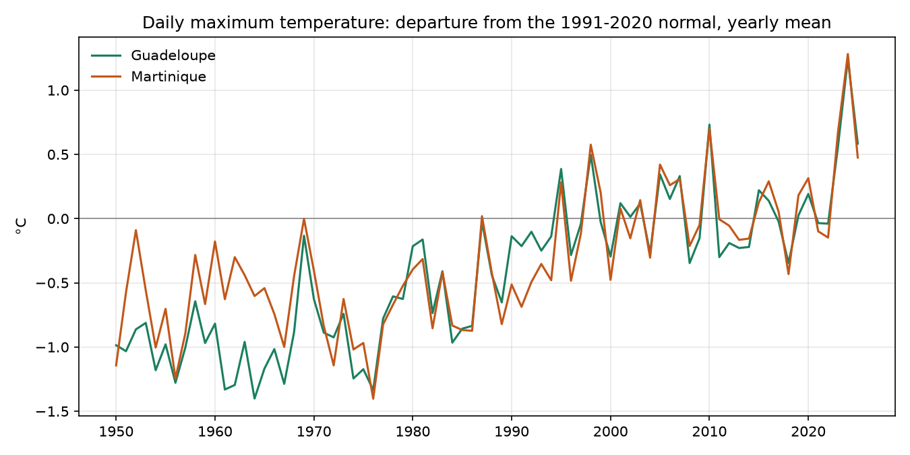
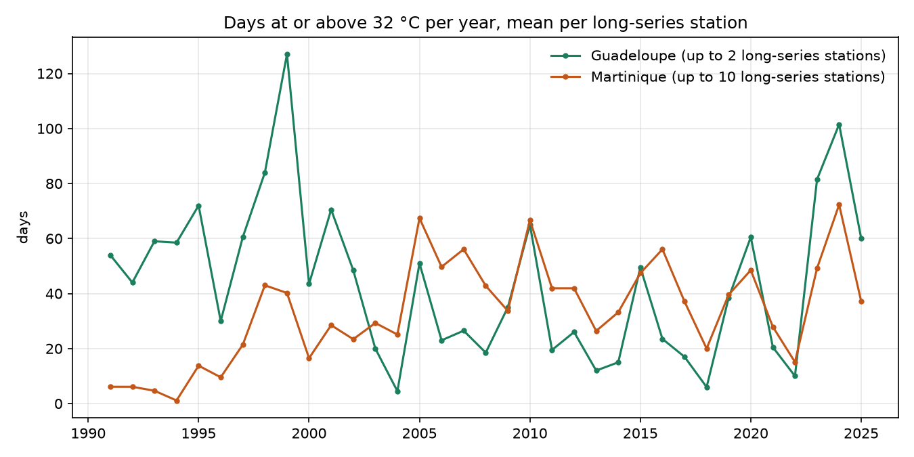
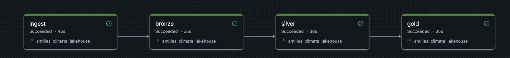
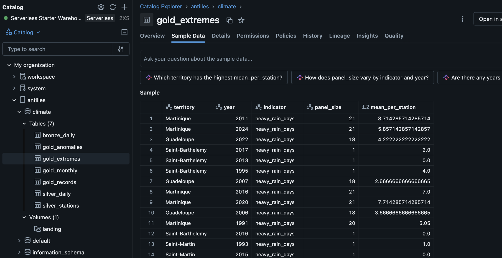

# Antilles Climate Lakehouse

How has the climate of **Guadeloupe** and **Martinique** changed? Météo-France publishes
the daily measurements of every station of the islands since 1950 as open data. This project
turns them into a medallion lakehouse (bronze, silver, gold) in **PySpark** and **Delta
Lake**, tested locally and deployed to **Databricks** as a serverless job, with its tables in
Unity Catalog.



Both islands warm together: the yearly mean departure of the daily maximum from its
1991-2020 normal goes from about −1 °C in the 1950s-1970s to +1.2 °C in 2024, the warmest
year of the series. Each station is compared with its own normal, then the yearly value is
the mean over the stations measured that year; the network changes over the decades, which
comparing each station with itself limits but does not remove.



Fourth piece of a portfolio on the same islands, after
[antilles-data-pipeline](https://github.com/tomtessondev/antilles-data-pipeline) (batch),
[caribbean-sensor-pipeline](https://github.com/tomtessondev/caribbean-sensor-pipeline) (IoT)
and [caribbean-ais-stream](https://github.com/tomtessondev/caribbean-ais-stream) (streaming).

## Architecture

```
 data.gouv.fr API ──► ingest ──► landing volume ──► bronze ──────────► silver ─────────────► gold
 (dataset of daily    lists the   one .csv.gz per   rows as text,      typed, cleaned,       monthly, anomalies,
  climate series)     971/972     file, sha1 +      one current copy   MERGE on (station,    extremes on a station
                      files       manifest          per file           day), stations        panel, records
```

On Databricks the four steps are the four tasks of one serverless job, deployed with a
Databricks Asset Bundle (`databricks.yml`, `resources/climate_job.yml`); the tables live in
`antilles.climate`. Locally the same code runs on a Spark with Delta, tables under `data/`.





| Part | Tooling | Where |
| --- | --- | --- |
| Sources | data.gouv.fr API, httpx, files fingerprinted (sha1) while they stream | `src/antilles_lakehouse/sources.py` |
| Bronze | Delta, one current copy per file (`replaceWhere`), history by time travel | `bronze.py` |
| Silver | typing, physical bounds, quality codes, Delta `MERGE`, station dimension | `silver.py` |
| Gold | monthly climate, 1991-2020 normals and anomalies, extremes on a station panel, records | `gold.py` |
| Jobs | one entry point per step, local or Unity Catalog | `jobs.py`, `tables.py` |
| Deployment | Databricks Asset Bundle, serverless environment 4, Databricks Free Edition | `databricks.yml`, `resources/` |
| Quality | pytest on a local Spark (bronze, silver, gold, the whole job), respx, ruff, mypy `--strict`, GitHub Actions | `tests/`, `.github/workflows/ci.yml` |

## The data

[Données climatologiques de base - quotidiennes](https://www.data.gouv.fr/datasets/donnees-climatologiques-de-base-quotidiennes):
one gzip CSV per department and period, `;`-separated, one row per station and day, every
measure with a quality code (0 protected, 1 validated, 9 filtered, 2 doubtful). This project
uses the rain, temperature and wind files ("RR-T-Vent") of departments 971 and 972 from
1950: about 2.3 million station-days, 157 stations.

## Rules worth knowing

- **Republished files.** Météo-France rewrites its files in place, the whole history
  included, and renames them when a period rolls over each year. Bronze keeps one current
  copy per file: the same bytes are skipped, a changed file replaces its own rows, and
  Delta's history keeps the replaced copies. Silver keeps, per station and day, the row of
  the most recently modified file and merges it: a row is rewritten only when a value or a
  quality code changed, so a correction rewrites that one row and an unchanged
  republication rewrites none (the tests check both through Delta's operation metrics).
  Gold is small and rebuilt on every run.
- **Territories.** The 971 files also cover Saint-Barthélemy and Saint-Martin, over 200 km
  north of Guadeloupe; each station gets its territory from the commune code in its id.
- **A changing station network.** Stations open and close over the decades; summing them
  would show a trend made by the network. Every indicator is computed per station, and a
  territory's figure is the mean over a fixed panel of long-series stations: 80 % of days
  present in every decade from 1991 to the last complete year. A panel station counts in a
  given year only if that year is itself 80 % measured, so a year with three months of
  data does not pass for a calm year. Few stations have such a temperature series: up to 2
  stations in Guadeloupe and 10 in Martinique for hot days, 18 and 21 for heavy rain.
  `gold_extremes` stores, with each figure, how many stations it is the mean of.
- **Quality.** Doubtful values stay in silver with their code but never reach gold;
  physically impossible ones (outside −10…50 °C, 0…1500 mm, 0…100 m/s) become null.
- **Thresholds.** A very hot day reaches 32 °C; a heavy-rain day, 50 mm. The normal is the
  1991-2020 mean per station and calendar month where at least 20 years have that month
  complete (80 % of its days).
- **Records** come from every station, including secondary networks (local authorities):
  the hottest days of the series, 38.4-38.7 °C in 2024-2025, are validated values from
  such stations.

## Running it

```bash
python -m venv .venv && source .venv/bin/activate
make install        # the package with its local Spark (Java 17 needed: JAVA_HOME)
make check          # ruff, mypy, the tests on a local Spark
make run-local      # the whole pipeline on the real files, tables under data/
python scripts/charts.py data   # the charts above, from the local gold tables
```

On Databricks (Free Edition is enough), from this folder:

```bash
databricks auth login --host https://<your workspace>.cloud.databricks.com
databricks bundle deploy      # the wheel and the job "antilles-climate" (schedule paused)
databricks bundle run climate # ingest, bronze, silver, gold: about 3 minutes
```

The first run creates the catalog `antilles`, the schema `climate` and the volume `landing`.
`databricks bundle destroy` removes the job; `DROP CATALOG antilles CASCADE` the tables.

## Design choices

- **The same code everywhere.** The layers are functions of a Spark session and table
  names. Tests, local runs and the Databricks job call the same functions; only the names
  (local or `antilles.climate.*`) and the session change.
- **Spark stays out of the job's wheel.** On Databricks the serverless environment provides
  Spark; a wheel that declared `pyspark` would replace it. PySpark and delta-spark are a
  `local` extra, pinned to the serverless environment's versions (Spark 4.0, Python 3.12).
- **Spark expressions, no Python UDF.** The territory of a station is a `CASE` expression:
  no Python worker round trip, the same plan locally and on serverless.
- **Delta where it earns its place.** `replaceWhere` in bronze, `MERGE` with a change
  condition in silver, time travel in the tests, schema overwrite for the rebuilt gold
  tables.

## Roadmap

See [docs/ROADMAP.md](docs/ROADMAP.md).

## Author

Tom Tesson, data engineer and FPGA/embedded engineer, based in Guadeloupe (UTC−4).
